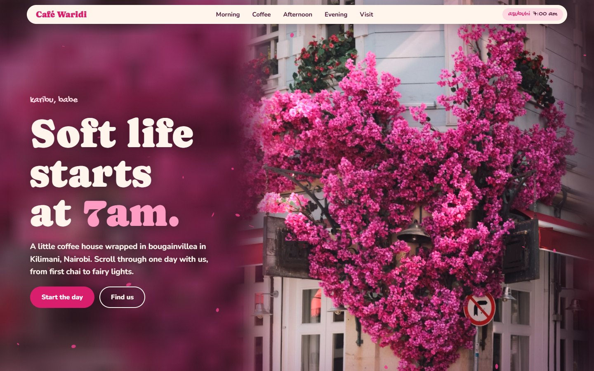
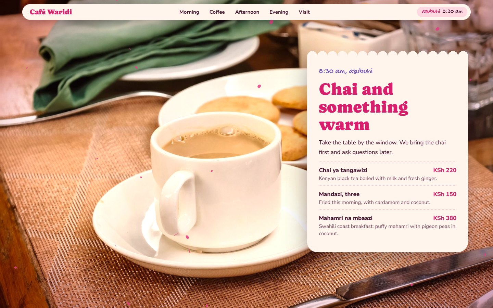
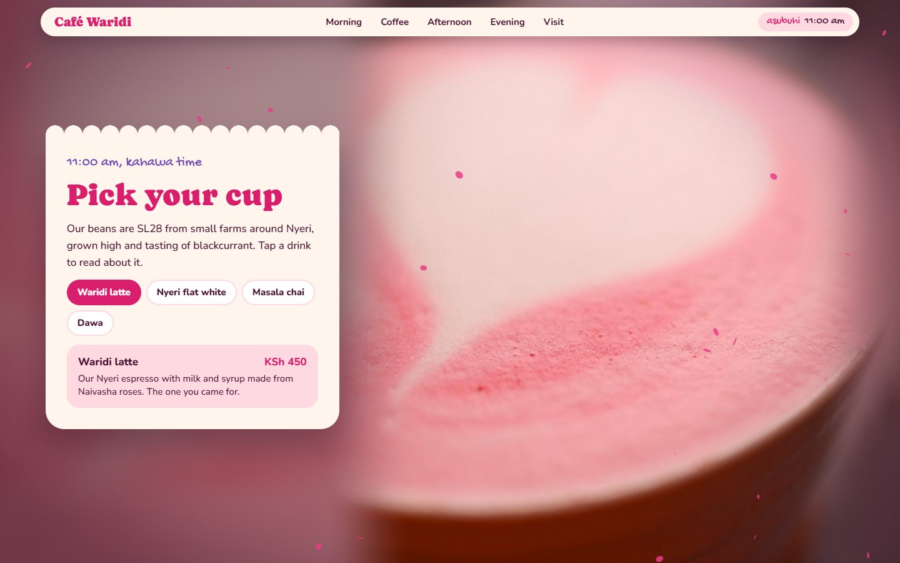
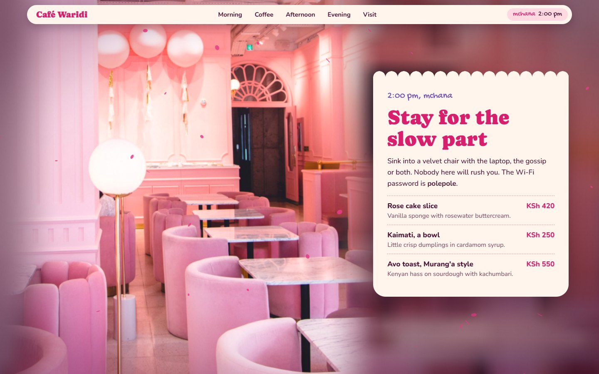
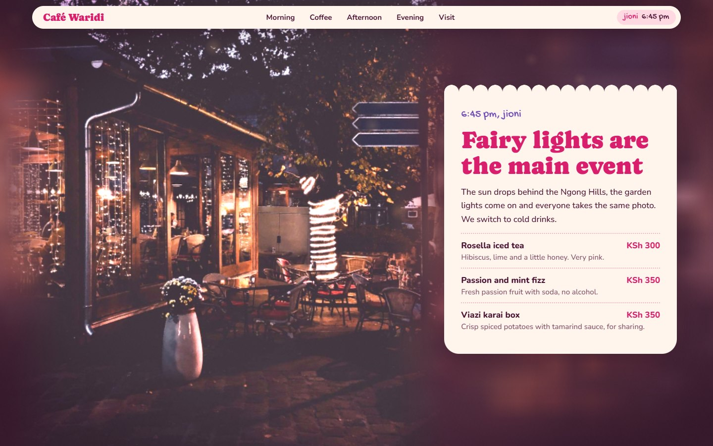
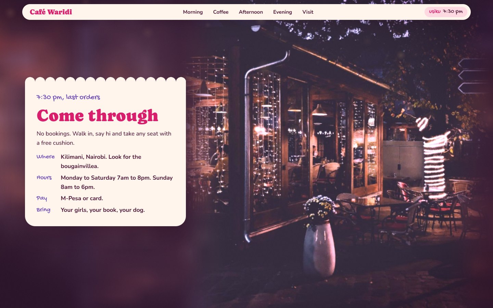
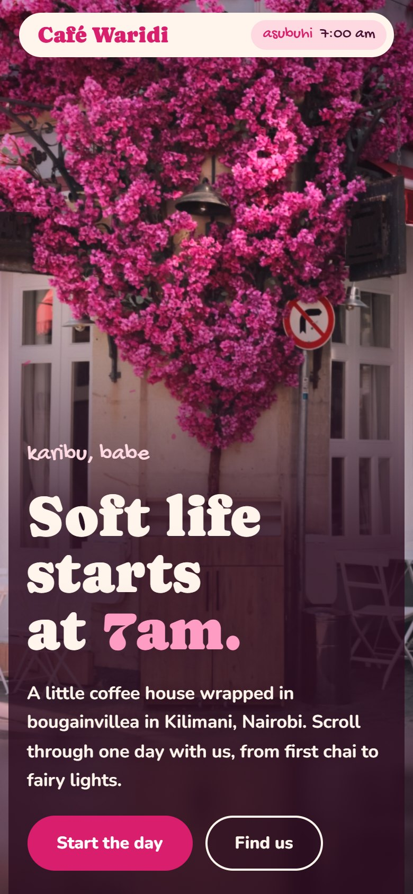
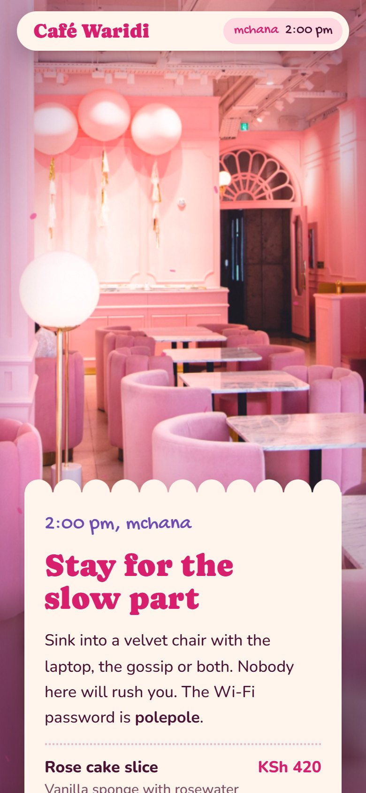
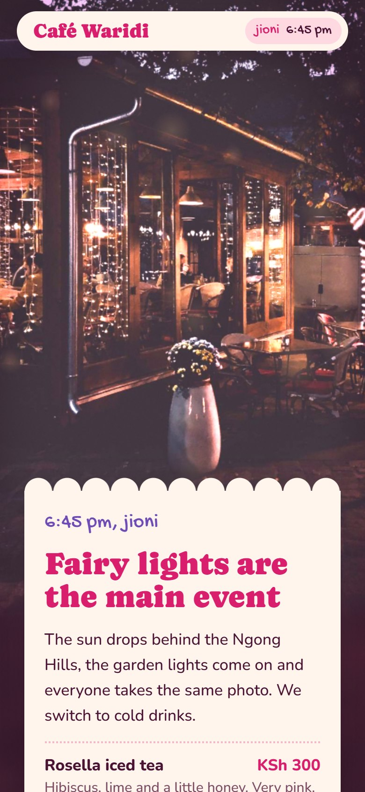

# Café Waridi

A cinematic, scroll-driven website concept for a cute pink coffee house in Nairobi. *Waridi* is Swahili for rose.

**[See it live](https://kare100.github.io/cafe-waridi/)**

Scrolling walks you through one day at the café, from 7am chai to fairy lights at dusk. A clock in the nav runs as you go, and the photos push in, tilt and dissolve into each other.

> **This is a design concept.** Café Waridi is fictional, so its menu, prices, hours and location are invented. The photos are stock images taken elsewhere, not of a Kenyan venue.



## Screenshots

### Through the day

| | |
|---|---|
|  |  |
| **8:30am, asubuhi.** Chai and something warm | **11am, kahawa time.** Pick your cup |
|  |  |
| **2pm, mchana.** Stay for the slow part | **6:45pm, jioni.** Fairy lights are the main event |



### On a phone

| | | |
|---|---|---|
|  |  |  |

## Features

- **One day as a scroll story.** Six stops, each with its own photo, camera move and colour grade.
- **Soft 3D from flat photos.** A WebGL shader shifts each photo using a hand-placed depth map, so the foreground and background move separately as you scroll or move the mouse.
- **Tall photos that work on wide screens.** On desktop, each photo melts into a blurred copy of itself, leaving room for the card.
- **Atmosphere.** Pink petals by day and a soft string-light glow after dark.
- **Kenyan details.** Swahili time-of-day words, KSh prices, M-Pesa, mandazi, dawa, Nyeri coffee and the proverb *Haraka haraka haina baraka* (hurry, hurry has no blessing).
- **Built to degrade gracefully.** It lowers its resolution on slow devices, honours reduced-motion settings, and falls back to plain section backgrounds without WebGL 2.

## Run it locally

There is no build step or dependency to install. The page needs a local server, because browsers block WebGL from loading images over `file://`.

```bash
python -m http.server 8000
```

Then open <http://localhost:8000>.

You can also host the folder as it is on any static host, such as GitHub Pages, Netlify or Vercel.

## Project structure

```text
index.html           The whole site: markup, styles, shader and scroll logic
photos/              The five photos, resized and retouched
docs/screenshots/    Images used in this README
```

## Make it your own

Everything to change is in `index.html`:

- **Text and menus:** edit the HTML in each `<section>`.
- **Drinks:** edit the `DRINKS` list.
- **Photos and framing:** edit `PHOTOS` for the focal point, zoom and depth map.
- **Colour and timing:** edit `SHOTS` for the layout side, clock time and colour grade.
- **Brand colours and fonts:** edit the variables under `:root`.

## Tech

Plain HTML, CSS and JavaScript with raw WebGL 2, plus Google Fonts (Caprasimo, Nunito and Gochi Hand). No framework or 3D library.

## Photo credits

All photos are from [Pexels](https://www.pexels.com) and used under the [Pexels licence](https://www.pexels.com/license/).

| Used for | Photo | Photographer | Edits |
|---|---|---|---|
| Hero | [Purple blossoms on a building corner](https://www.pexels.com/photo/purple-blossoms-on-tree-on-building-corner-17886486/) | Necip Duman | Business name and logo removed |
| Morning | [Tea and cookies](https://www.pexels.com/photo/cozy-breakfast-setting-with-tea-and-cookies-34451330/) | Michael Takahashi | None |
| Coffee | [Heart latte art](https://www.pexels.com/photo/heart-latte-art-on-pink-colored-coffee-35672933/) | Valeria Boltneva | None |
| Afternoon | [Light pink café interior](https://www.pexels.com/photo/the-interior-of-a-light-pink-themed-cafe-7688356/) | Taryn Elliott | None |
| Evening | [Flowers and string lights](https://www.pexels.com/photo/white-flowers-outside-brown-building-with-string-lights-3146186/) | Bala | Street sign text removed |

All photos are also colour-graded live in the browser.

The Pexels licence doesn't allow implying that a brand or person shown in a photo endorses you, or using a photo as part of a trademark or business name. If this becomes a real business, replace these with your own photos.

## Licence

No licence has been chosen for the code yet, so all rights are reserved by default. The photos stay under the Pexels licence.
